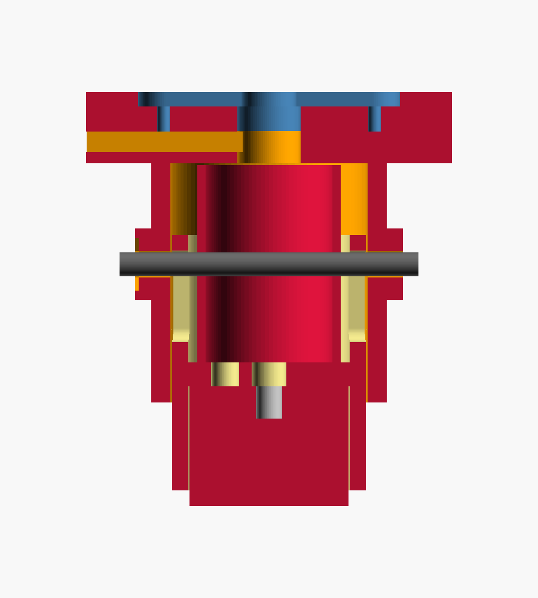

# Electromagnet end effector

Spring-loaded housing for the **KK-P20/15** 12 V lifting electromagnet (Ø20 × 15 mm, up to
3 kg on flat steel). It replaces the arm's gripper. Everything comes from one parametric
file, `magnet_effector.scad`. The STLs in `stl/` are rendered with the default numbers.



```
 wrist servo horn
 ├─ adapter_horn   (or adapter_bolt)     5 mm disk, 4 × M3 nuts trapped on the servo side
 ├─ sleeve         flange + tube, Ø29.6 mm, lead channel on top, M3 cross pin
 │    spring       inside the carrier, pushes it down
 ├─ carrier        slides 8 mm up inside the sleeve, held by the cross pin in two slots
 └─ magnet         screwed into the carrier through its rear threaded hole, face 2 mm proud
```

At rest, the distance from the top of the adapter to the magnet face is **52 mm**. When pressed
on a part, the carrier slides up as much as 8 mm.

## Why a spring

The magnet only reaches its rated force when its face sits flat against the part. A
servo arm misses by a few millimetres, so the software drives the tool 3 mm below the
part's top (`PRESS_DEPTH` in `host/config.py`). The spring takes that up and the face
seats flat every time. If you don't want the spring, `rigid_cup.stl` bolts straight to
the adapter, but then pick height has to be exact.

## Measure before printing

These dimensions could not be confirmed from the product listings:

| Parameter | Default | What to measure |
|---|---|---|
| `mag_d`, `mag_h` | 20, 15 | Magnet body. Sellers agree on 20 × 15. |
| `mag_screw_d` | 4.4 | Rear threaded hole. Sellers list M4; 4.4 clears both M4 and M3. |
| `wire_hole_r` | 5.5 | Distance from the centre to where the leads leave the rear face. |
| `horn_len`, `horn_w`, `horn_t` | 32.5, 6.5, 1.8 | Only for `adapter_horn`: the roll servo's cross horn (tip to tip, arm width, thickness). |
| `slot_r0`, `slot_r1` | 7, 15 | Only for `adapter_bolt`: the slots fit two holes 14–30 mm apart. |

Change the numbers at the top of `magnet_effector.scad`, then re-export with
`render_all.sh` or OpenSCAD → F6 → Export STL with `part` set to that part.

## Which adapter

* **`adapter_bolt`** (plate mount, `TOOL_MOUNT = "plate"`): for arms where the gripper sits
  on a flat plate fixed to the wrist-pitch servo, with no wrist-roll servo. The RoboWings
  kit looks like this. Strip the jaws and gripper servo off the plate, keep the plate, and
  bolt the adapter flat underneath it. Its four radial slots fit any two holes 14–30 mm
  apart on a line through the magnet centre. If none line up, drill two 3.2 mm holes
  20 mm apart.
* **`adapter_horn`** (inline mount, `TOOL_MOUNT = "inline"`): for arms with a wrist-roll
  servo whose horn faces along the arm. The cross horn drops into the pocket, and 4 small
  self-tapping screws go through the horn's outer holes. Fit the horn to the servo through
  the 8 mm hole before bolting on the sleeve.

## Bill of materials

| Qty | Part |
|---|---|
| 1 | KK-P20/15 12 V electromagnet |
| 1 | Compression spring, OD 16–19 mm, free length 28–35 mm, light (spring assortment box) |
| 4 | M3 × 10 screws + M3 nuts (sleeve to adapter) |
| 1 | M3 × 35 screw + M3 nut (cross pin) |
| 1 | M4 × 8 screw for the magnet's rear hole (M3 × 8 if yours is M3) |
| 4 | M2 × 6 self-tapping screws (horn to adapter) |
| 1 | Logic-level MOSFET module or IRLZ44N, 1N4007 / 1N5819 diode, 220 Ω, 10 kΩ |
| 1 | 12 V supply, ≥ 0.5 A |

## Printing

**Use PETG** for all four parts. The RoboWings arm itself is listed as PETG, so the
housing matches its stiffness and heat behaviour.

| Filament | Softens at | For this housing | Why |
|---|---|---|---|
| **PETG** | ~80 °C | **Use this** | Takes coil heat, tough rather than brittle, low creep under the spring, slides well, easy to print. |
| ABS | ~100 °C | Works, second choice | Most heat-resistant, but warps and cracks between layers without an enclosure, and gives off fumes. |
| PLA | ~55–60 °C | Test fits only | Stiff and accurate, but the warm coil plus spring load slowly deforms it, and it is brittle under screws. |
| TPU | flexible | Do not use for these parts | Too soft to hold position. A TPU pad on the magnet face would add an air gap and cut the holding force. |

PLA is fine for a quick fit check of the adapter on your servo horn before the PETG print.

* 0.2 mm layers, 4 walls, 40 % infill.
* No supports. Print the carrier pocket-down, the sleeve flange-down and the adapters flat.
* If the carrier binds in the sleeve, raise `fit_slide` from 0.5 to 0.6–0.7 and reprint
  the carrier. Sand lightly if needed.

## Assembly

1. Screw the magnet into the carrier through the centre hole. Feed its leads up through
   the 3.5 mm hole beside it.
2. Drop the spring into the carrier, around the screw head and the leads.
3. Push the carrier into the sleeve, line up the slots with the side holes, and slide the
   M3 × 35 cross pin through. Put the nut in its hexagon trap. The carrier should now
   spring back after being pushed up about 8 mm.
4. Route the leads up through the sleeve's centre hole and out sideways along the channel
   on top of the flange.
5. Fix the adapter to the wrist, then bolt the sleeve to it with 4 × M3 (nuts sit in the
   adapter's traps).
6. Measure the head's offset from the wrist pitch axis and set `TOOL_MOUNT`, `TOOL_FORWARD`
   and `TOOL_DOWN` in `host/config.py`. The install guide shows how.

## Wiring

```
+12V ──────┬──────────── magnet lead A
           │
     1N4007 / 1N5819   (stripe towards +12V)
           │
MOSFET D ──┴──────────── magnet lead B
MOSFET S ── GND  (12 V GND, servo GND and Arduino GND all joined)
MOSFET G ── 220 Ω ── Nano D7  /  ESP32 GPIO18      (+ 10 kΩ from G to GND)
```

Never drive the coil straight from a pin, and never leave out the diode.

## Limits of a magnet

* **It only lifts steel.** Plain or zinc-plated steel works. Stainless A2/A4, brass and
  aluminium will not lift. Test every part with a fridge magnet first.
* **Contact area.** Holding force drops a lot on small or curved contact. A flat washer or
  nut is easy. A bolt lying on its side touches only along a line, so it lifts with far
  less force, but a few grams is still well within reach.
* **Neighbours.** The magnet attracts parts within a few mm, so the sorter picks isolated
  parts first (`ISOLATION_MM`).
* **Residual magnetism** can hold a light washer for a moment after switch-off. The sorter
  waits `RELEASE_DWELL_MS` over the bin before moving away.

## Swinging hanger for the 3-joint arm (`magnet_hanger.scad`)

The arm on the bench has no wrist servo, so a magnet bolted to the forearm tilts with it.
`stl/magnet_hanger.stl` is a U-shaped TPU hanger that hooks into two Ø6 mm holes drilled
straight across the forearm end (17.5 mm up from its bottom edge, 17.5 mm back from its front
edge). It swings freely, so gravity keeps the magnet face pointing down.

* Print `stl/magnet_peg_test.stl` first (2 minutes) and try it in a drilled hole. The peg
  should turn freely, and the barb should click through the wall (modelled as 8 mm; the measured wall is about 7 mm, so expect ~1 mm of side play).
* Print the hanger flat as exported, in TPU 95A, with no supports, slowly (20-25 mm/s).
* Fit it by pulling one arm outward and pushing its peg in until the barb pops through, then the other side. The 4.5 mm pegs spin freely in the 6 mm holes.
* Fix the magnet under the bottom bar with an M3 screw and washer (the hole also passes M4).
* Pivot to magnet face is 62 mm. After fitting, set `TOOL_SELF_LEVELING = True` and
  `TOOL_DOWN = 62.0` in `host/config.py`, and set `L3` to the elbow axis → drilled hole distance.
* If your measurements differ (wall thickness, width, hole size), change the numbers at the
  top of `magnet_hanger.scad` and re-export.

**Stiff-plastic option (PLA or PETG): `stl/magnet_hanger_petg.stl` (the final version).** Plain 4.0 mm pegs that go
5 mm into the holes, with no barbs: the stiff arms keep the pegs in, because the magnet only
pulls straight down. Fitting needs about 6 mm of bend per arm, which is safe even for PLA if you
do one arm at a time. PLA softens around 55 °C, so it is fine for testing (the firmware cuts the
magnet after 30 s on); reprint in PETG for long runs. Pivot to magnet face is 61 mm (`TOOL_DOWN = 61.0`).
The TPU barbed version (`stl/magnet_hanger.stl`, 62 mm) is still there.
